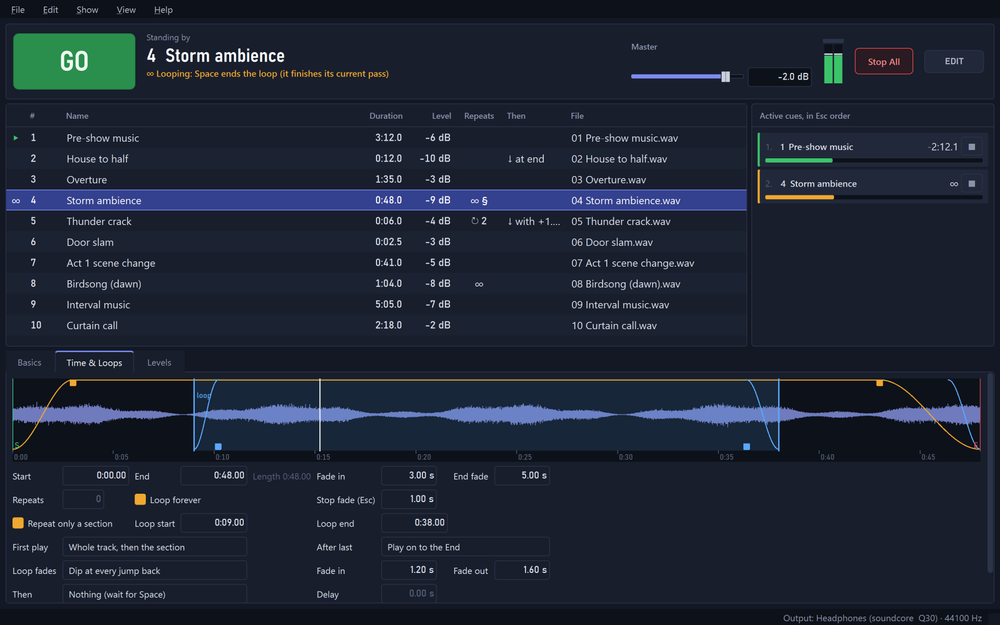
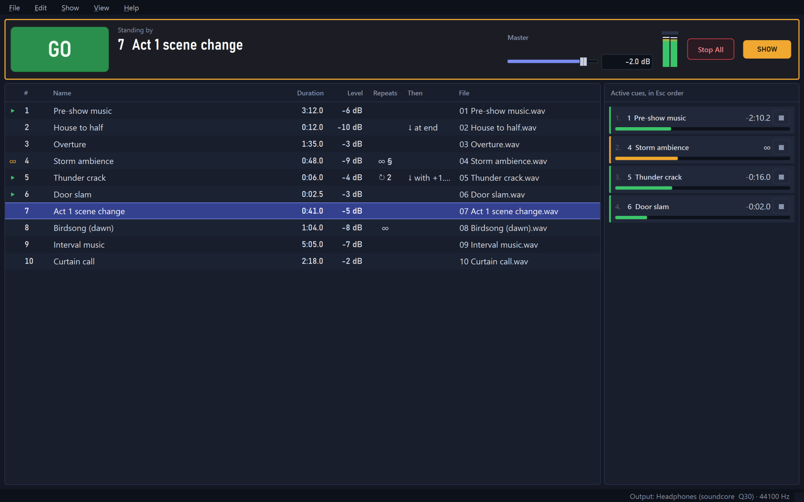

<div align="center">


# WinQ

**Reliable audio cue playback for live shows on Windows.**

Build a list of sound cues, then run the whole show from the space bar.

[](https://github.com/MszBen/WinQ/releases/latest)
[](#system-requirements)
[](#building-from-source)
[](https://wiki.qt.io/Qt_for_Python)
[](LICENSE.txt)

[**Download**](https://github.com/MszBen/WinQ/releases/latest) ·
[Features](#features) ·
[Quick start](#quick-start) ·
[User guide](#user-guide) ·
[Shortcuts](#keyboard-shortcuts) ·
[Build from source](#building-from-source)

<br>



</div>

<br>

WinQ is a cue-based sound playback app for theatre, events, dance, worship and any
production where sound has to happen exactly on cue. You prepare cues in advance
(trims, fades, loops, levels, automatic follow-ons), then the operator presses **Space**
for each one. Several cues play at once, **Esc** fades them out oldest-first, and
**Shift+Esc** stops everything.

WinQ is deliberately **audio-only**: no lighting, video or network control. It does one
job, with a sample-accurate audio engine and an interface built for dark booths and
small laptop screens.

> [!NOTE]
> WinQ is in **public beta (0.9.0)**. Always test your show and your audio hardware with
> WinQ before relying on it in a performance.

## Features

<table>
<tr>
<td width="50%" valign="top">

### 🎬 Built for the booth
- **One-key GO.** Space starts the standing-by cue and moves on to the next one.
- **Esc stops the oldest** cue with its own fade; press again for the next one.
- **Active Cues panel** in Esc order, with time left and a stop button per cue.
- **Show mode** (Ctrl+M) locks every edit, keeps the PC awake and frames the GO bar in
  amber, so nothing changes by accident mid-show.
- **Double-GO guard** ignores an accidental second press.
- Dark, high-contrast theme with large type for low-light booths.

</td>
<td width="50%" valign="top">

### 🔊 Sample-accurate engine
- Everything is mixed in **one low-latency stream** (WASAPI by default).
- **Overlap anything**, including several copies of the same cue.
- **Gapless loops and follow-ons**, accurate to the sample.
- **Live level changes**, smoothed so there are no clicks.
- S-curve fades everywhere, and a de-click ramp on every stop.
- Plays **WAV, MP3, FLAC, OGG and AIFF**, resampled to your device.

</td>
</tr>
<tr>
<td width="50%" valign="top">

### ✂️ Time &amp; Loops editor
- **Waveform editor** with draggable Start/End trims and fade handles.
- **Non-destructive**: your audio files are never modified.
- **Repeats** (a fixed number) or **loop forever** until the next GO.
- **Loop a section only**, with an intro and an optional outro.
- **Loop fades**: a dip or a crossfade at the loop point.
- **Preview** from any point without touching the show.
- Every edit applies **live** to copies that are already playing.

</td>
<td width="50%" valign="top">

### 🛟 Safe by design
- **Autosave & crash recovery.** Backups are kept separately, so your show file is
  never overwritten.
- **Missing-file detection** in red, plus **Relink** (fixes a whole folder at once).
- **Output watchdog** warns at once if the audio device disappears.
- Asks before quitting while cues play.
- Errors are logged, and WinQ **keeps running**.
- Unlimited **undo / redo** for every edit.

</td>
</tr>
</table>

<div align="center">

<br>
<sub><i>Show mode with the inspector hidden (Ctrl+E): editing is locked, the GO bar is framed in amber, and four cues are running in Esc order.</i></sub>
</div>

## Download

1. Download **`WinQ-0.9.0-Setup.exe`** from the
   [latest release](https://github.com/MszBen/WinQ/releases/latest).
2. Run it. WinQ installs **for your user account only**, so no administrator password is
   needed. It goes to `%LOCALAPPDATA%\Programs\WinQ`.
3. Start WinQ from the Start menu, or double-click any `.winq` show file.

The installer adds a Start menu entry and an optional desktop shortcut, and makes
`.winq` files open in WinQ. Uninstall from **Settings → Apps**; your preferences and
autosaves are kept.

> [!TIP]
> The installer isn't code-signed yet, so Windows SmartScreen may say
> *"Windows protected your PC"*. Choose **More info → Run anyway**.

### System requirements

| | |
|---|---|
| **OS** | Windows 10 or 11, 64-bit |
| **Audio** | Any Windows output device (WASAPI, DirectSound, MME or WDM-KS) |
| **Memory** | About 23 MB of RAM per minute of loaded audio (48 kHz stereo) |
| **Screen** | 1024 px wide or more |

## Quick start

1. **Add sounds.** Drag audio files (or a whole folder) onto the cue list, or use
   *File → Add Audio Files…* (Ctrl+I). Cues are numbered and named for you.
2. **Shape each cue.** Select a cue and use the inspector below the list. In *Time &
   Loops*, drag the green and red lines to trim and the amber handles to fade. Use
   *Levels* to set the cue's level.
3. **Chain cues if you like.** *Then → When this one ends* starts the next cue
   seamlessly, and *With this one* starts it after a delay.
4. **Save** the show (Ctrl+S). Keep the `.winq` file in the same folder as your audio
   so you can move the whole folder to another computer.
5. **Run the show.** Press **Ctrl+M** for Show mode, then **Space** for each cue.

## Keyboard shortcuts

| Running a show | | Editing | |
|---|---|---|---|
| <kbd>Space</kbd> | **GO**: start the standing-by cue (or end its loop) | <kbd>Ctrl</kbd>+<kbd>I</kbd> | Add audio files |
| <kbd>Esc</kbd> | Fade out the oldest playing cue | <kbd>Delete</kbd> | Delete the selected cue |
| <kbd>Shift</kbd>+<kbd>Esc</kbd> | **Stop All** (also cancels automatic starts) | <kbd>Ctrl</kbd>+<kbd>L</kbd> | Relink a missing file |
| <kbd>↑</kbd> / <kbd>↓</kbd> | Move the selection | <kbd>Ctrl</kbd>+<kbd>Z</kbd> / <kbd>Ctrl</kbd>+<kbd>Y</kbd> | Undo / Redo |
| <kbd>Ctrl</kbd>+<kbd>M</kbd> | Edit / Show mode | <kbd>Ctrl</kbd>+<kbd>E</kbd> | Show / hide the inspector |
| <kbd>F1</kbd> | All shortcuts | <kbd>Ctrl</kbd>+<kbd>,</kbd> | Preferences |

Space and Esc work wherever the focus is, except while you're typing in a text field.
Holding a key down never fires it twice.

## User guide

<details>
<summary><b>How GO works</b></summary>

<br>

- **Space** starts the selected (*standing-by*) cue and moves the selection to the next
  cue.
- **Loop-forever cues:** Space starts the cue, and the selection **stays on it**. The
  next Space ends the loop: the cue finishes its current pass and stops (or plays its
  outro). Nothing new starts. The Space after that goes on to the next cue.
- **Fixed repeats** (for example "repeat 2") always play every pass. Space never cuts
  them short.
- **Space on a cue that's already playing** starts a second, overlapping copy.
- **Missing files** are shown in red. Space skips them with a warning and moves on.
- **Automatic starts:** after Space on a cue that's chained to the next ones, the
  selection jumps past the whole chain. Waiting cues show as *waiting* in Active Cues.
- The selection can always be moved freely (arrows or click), even while a cue loops.
  To end that loop later, select the cue again and press Space.

</details>

<details>
<summary><b>Time &amp; Loops</b></summary>

<br>

| Setting | What it does |
|---|---|
| **Start / End** | Non-destructive trim points. Dragging End to the end of the file means "play to the end". |
| **Fade in** | From Start, on the first pass only. |
| **End fade** | Before End, on the final pass only. |
| **Stop fade (Esc)** | How long Esc takes to fade this cue out. |
| **Repeats** / **Loop forever** | Extra passes, or loop until the next GO on this cue. |
| **Repeat only a section** | Repeats play only between the blue *Loop start* and *Loop end* lines. The first play is either the whole track or an intro into the section. After the last repeat, the cue either stops at Loop end or plays on to End. |
| **Loop fades** | A dip at each jump back, a dip at Loop end only, a fade on every pass, or a seamless **crossfade**. |
| **Then** | *Nothing*, *When this one ends* (+ delay, sample-accurate), or *With this one* (after a delay). |

On the waveform, **Ctrl+wheel** zooms, **wheel or drag** pans and **double-click** fits
the whole file. Click to set the **preview point**, then press **Preview** to hear the
cue from there. Times can be typed exactly as `m:ss.cc`.

Every change applies **live**, including to copies already playing and to the preview.

</details>

<details>
<summary><b>Show mode</b></summary>

<br>

**Ctrl+M**, the EDIT/SHOW button or *Show → Show Mode* locks the show. Adding,
deleting, reordering, inspector edits, preview, undo and Preferences are all disabled.
GO, Esc, Stop All, the selection, the master fader and saving still work. While Show
mode is on, Windows is kept from sleeping or turning off the screen.

Turn on *Preferences → Show → Open shows in Show mode* to have every show you open start
locked.

</details>

<details>
<summary><b>Files, autosave and recovery</b></summary>

<br>

- Shows are `.winq` files (JSON). Audio paths are stored **relative to the show file**,
  so a show folder can be copied to another computer as a whole.
- WinQ reopens the last show on launch, and *File → Open Recent* lists recent shows.
- **Autosave** (every 30 s by default) writes unsaved changes to a separate backup and
  never overwrites your `.winq`. After a crash, the next launch offers to recover it.
- Only one WinQ window runs at a time. Opening a `.winq` while WinQ is open brings that
  window forward and opens the show there.
- **Relink** (*Edit → Relink File…*, Ctrl+L) points a missing cue at a new file. Other
  missing files found in the same folder can be fixed in the same step.

</details>

<details>
<summary><b>Preferences</b></summary>

<br>

| Tab | Options |
|---|---|
| **Audio** | Output device; buffer size (*Low*, *Normal* or *Safe*); left/right **test tone** |
| **Show** | Stop All fade; double-GO guard (0.3 s by default); open shows in Show mode |
| **New cues** | Default level, fade in, end fade, Stop fade and *Then* for new cues |
| **Display** | UI size (100 / 115 / 130 %); notes in the GO bar; time remaining or elapsed; loop fades on whole-track repeats |
| **Files** | Reopen the last show on launch; autosave interval |

</details>

<details>
<summary><b>Troubleshooting</b></summary>

<br>

| Problem | Try this |
|---|---|
| Crackles or dropouts | *Preferences → Audio → Buffer → Safe* (this also helps with Bluetooth). |
| *"Audio output stopped"* in red | The device was unplugged or taken over by another app. Reconnect it, or pick it again in Preferences. |
| No sound at all | Use *Preferences → Audio → Play test tone*, and check the master fader and the Windows volume. |
| A cue shows in red | The file has moved. Use *Edit → Relink File…* (Ctrl+L). |
| Something went wrong | WinQ keeps running and writes the details to a log. Use *Help → Open Log Folder* and include the log when you report a problem. |

</details>

## Building from source

Requires **Python 3.12 (64-bit)** on Windows.

```powershell
git clone https://github.com/MszBen/WinQ.git
cd WinQ
py -3.12 -m venv .venv
.venv\Scripts\Activate.ps1
pip install -e ".[dev]"
python -m winq                      # or: python -m winq path\to\show.winq
```

**Tests and lint**

```powershell
pytest
ruff check . ; ruff format --check .
```

**Release build.** This needs [Inno Setup 6](https://jrsoftware.org/isinfo.php)
(`winget install JRSoftware.InnoSetup`):

```powershell
powershell -ExecutionPolicy Bypass -File tools\build_release.ps1
```

The script runs the tests, builds `dist\WinQ\WinQ.exe` with PyInstaller, smoke-tests it
against the real audio device, and packages
`dist\installer\WinQ-<version>-Setup.exe`. The version comes from
`src/winq/__init__.py`.

### Architecture

```
GUI thread (Qt / PySide6)                    Audio thread (PortAudio callback)
─────────────────────────                    ─────────────────────────────────
Transport (GO / Esc rules) ──commands──► queue ──► Mixer: Voices → master → output
        ▲                                                  │
        └──────── QTimer (~30 Hz) ◄── events (started / ended / position)
```

| Package | Role |
|---|---|
| `winq.audio` | Engine, voices (one per playing copy), decoding and resampling, devices |
| `winq.control` | Transport: the GO, Esc and panic rules (plain Python, fully unit-tested) |
| `winq.model` | Cues, the cue list, and loading/saving `.winq` files |
| `winq.ui` | Main window, cue table, inspector, waveform, preferences |

The audio callback does no file I/O, takes no long-held locks and makes no Qt calls, and
it never raises. Every gain change is ramped, so nothing clicks. The engine is tested
offline by rendering it directly. See [CLAUDE.md](CLAUDE.md) for the full behaviour
spec and design decisions, and [docs/PLAN.md](docs/PLAN.md) for the roadmap.

## Licence

Copyright © 2026 Benedek Miko-Szabo and other contributors. **All rights reserved.**

WinQ is free to install and use, including for commercial productions. The source code
may not be copied, modified or redistributed without written permission. See
[LICENSE.txt](LICENSE.txt).

WinQ includes open-source components under their own licences, including Qt / PySide6
(LGPL v3), libsndfile and soxr (LGPL v2.1), PortAudio, NumPy and the Python runtime.
See [THIRD_PARTY_NOTICES.txt](THIRD_PARTY_NOTICES.txt) and the [licenses](licenses)
folder. In the app: *Help → Licences*.

<div align="center">
<br>
<sub>Made for the people in the booth.</sub>
</div>
